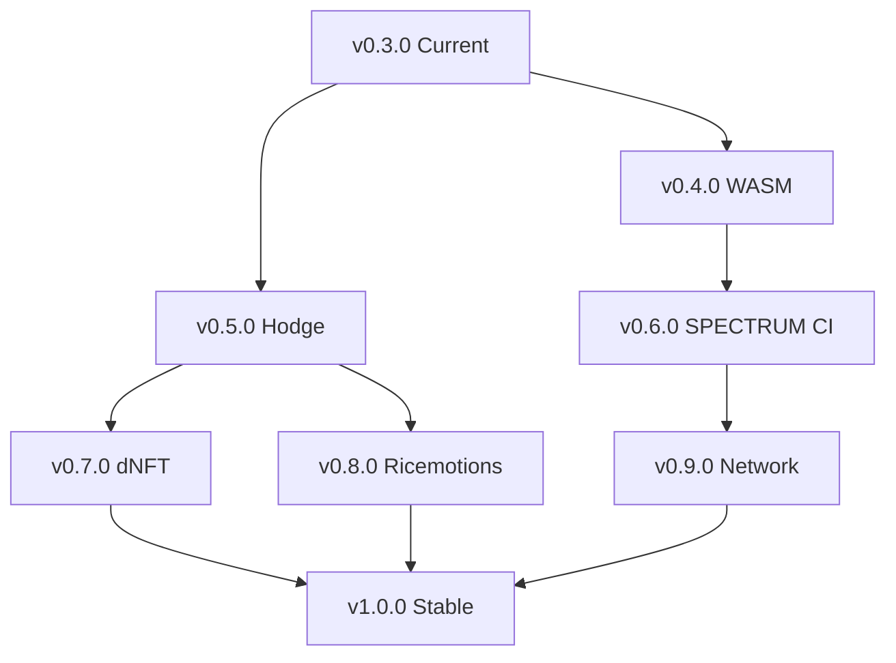

# Roadmap — MutaCore / Reino Digital

> **Visão:** Organismo Cibernético Completo — AGI Distribuída, Confiável, Biologicamente Inspirada
> **Versão Atual:** 0.3.0 (Core Rust + Simulações Python + Formalização LaTeX)
> **Última Atualização:** Outubro 2026

---

## Princípios do Roadmap

1. **Formal-First**: Toda feature tem especificação LaTeX antes da implementação
2. **Safety-Critical**: Validação Krajicek em toda mutação — zero exceções
3. **Thermodynamic-Aware**: ℛₗ como métrica de primeira classe
4. **Distributed-by-Default**: Quantum Packing para alocação ótima
5. **Self-Governing**: dNFT lineage + Q-ESCUDO para autonomia

---

## Versões Planejadas

### v0.4.0 — "WASM Sandbox" (Q4 2026)
**Foco**: Execução isolada e integração Rust↔Python

| Item | Descrição | Status | Responsável |
|------|-----------|--------|-------------|
| WASM Compilation | `cargo build --target wasm32-unknown-unknown` para origo-overlay | 🟡 Planejado | Rust Team |
| PyO3 Bindings | `validate_ast()`, `compute_landauer()`, `pack_work()` chamáveis de Python | 🟡 Planejado | Rust/Python Team |
| WASM Runtime | Execução no navegador (wasm-bindgen) + Node.js (wasmtime) | 🟡 Planejado | Rust Team |
| Sandbox Isolation | Resource limits (CPU, memory, syscalls) via wasmtime config | 🟡 Planejado | Rust Team |
| Integration Tests | E2E: Python → PyO3 → Rust → WASM → resultado | 🟡 Planejado | QA |

**Critério de Aceitação**: `python -c "from mutacore import validate; validate(ast_json)"` funciona.

---

### v0.5.0 — "Hodge n>6 & Equivariância" (Q1 2027)
**Foco**: Validação matemática rigorosa da Camada 1

| Item | Descrição | Status | Responsável |
|------|-----------|--------|-------------|
| Sparse Hodge n=8,10 | ARPACK + preconditioning para autovalores | 🟡 Planejado | Math Team |
| Equivariance Score | Métrica $\mathcal{E}$ monitorada em tempo real | 🟡 Planejado | Math Team |
| Perturbation Analysis | `analyze_equivariance_breaking()` automatizado no CI | 🟡 Planejado | Math Team |
| Formal Proof | Coq/Lean proof para teoremas de ΔT/Hodge | 🔴 Pesquisa | Formal Team |
| GPU Acceleration | CuPy/JAX para Hodge large-scale | 🔴 Pesquisa | Python Team |

**Critério de Aceitação**: `hodge_matrices.py --dimension 10 --analyze-breaking` roda em < 60s.

---

### v0.6.0 — "SPECTRUM-1024 CI Stability" (Q1 2027)
**Foco**: Prova contínua de estabilidade bijectiva

| Item | Descrição | Status | Responsável |
|------|-----------|--------|-------------|
| CI Integration | `spectrum1024_tests.py` no GitHub Actions (daily) | 🟡 Planejado | Crypto Team |
| Baseline Tracking | Avalanche, chi², differential prob — alerta se > 1% drift | 🟡 Planejado | Crypto Team |
| Formal Verification | Prova de permutação para S-box + key schedule | 🔴 Pesquisa | Formal Team |
| Side-Channel Resistance | Constant-time implementation audit | 🔴 Pesquisa | Crypto Team |
| Hardware Validation | Testes em FPGA/ASIC (se disponível) | 🔴 Pesquisa | Crypto Team |

**Critério de Aceitação**: Zero falhas bijectivas em 10M blocos aleatórios/dia.

---

### v0.7.0 — "dNFT Governance & Q-ESCUDO" (Q2 2027)
**Foco**: Camada 4 — Membrana e Governança

| Item | Descrição | Status | Responsável |
|------|-----------|--------|-------------|
| dNFT Minting | ERC-721 + ERC-4906 (metadata update) na testnet | 🟡 Planejado | Governance Team |
| Lineage Tracking | Grafo evolutivo on-chain (parent → child) | 🟡 Planejado | Governance Team |
| IP Registration | Timestamp + genome_hash = prior art proof | 🟡 Planejado | Legal/Tech |
| Q-ESCUDO NR-12 | Oráculo contra-factual para segurança industrial | 🟡 Planejado | Safety Team |
| Smart Contract Licensing | Revenue split automático via royalty standard | 🟡 Planejado | Governance Team |
| Audit Framework | Verificação formal de contratos (Slither, Certora) | 🔴 Pesquisa | Security Team |

**Critério de Aceitação**: Agente mutado → mint dNFT → deploy via packing → licença vendida.

---

### v0.8.0 — "Ricemotions: PIXEL/RIC/TEOA Pipeline" (Q2 2027)
**Foco**: Camada 3 — Metabolismo Completo

| Item | Descrição | Status | Responsável |
|------|-----------|--------|-------------|
| PIXEL Encoder | Visual/spatial state → tensor representation | 🔴 Pesquisa | ML Team |
| RIC Compressor | AST → reduced information code (lossy) | 🔴 Pesquisa | Core Team |
| TEOA Mapper | RIC → epistemological objects (semantic) | 🔴 Pesquisa | Formal Team |
| Landauer Monitoring | Per-stage dissipation tracking (PIXEL→RIC→TEOA) | 🟡 Planejado | Physics Team |
| Emotional States | ANXIETY/EXPLORATION/HOMEOSTASIS visuais | 🟡 Planejado | UX Team |

**Critério de Aceitação**: Pipeline completo roda em < 100ms por ciclo metabólico.

---

### v0.9.0 — "Distributed Consensus & Network" (Q3 2027)
**Foco**: Operação multi-nó real

| Item | Descrição | Status | Responsável |
|------|-----------|--------|-------------|
| P2P Overlay | libp2p integration para Origo Overlay | 🟡 Planejado | Network Team |
| Consensus Protocol | Proof-of-Complexity (Krajicek) para validação distribuída | 🔴 Pesquisa | Consensus Team |
| State Sync | CRDTs para estado metabólico distribuído | 🔴 Pesquisa | Network Team |
| Failure Detection | Heartbeat + metabolic health checks | 🟡 Planejado | Network Team |
| Load Balancing | Quantum Packing contínuo (rebalancing) | 🟡 Planejado | Core Team |

**Critério de Aceitação**: 10 nós + rede particionada → converge para estado consistente.

---

### v1.0.0 — "MutaCore Stable Release" (Q4 2027)
**Foco**: Release de produção

| Item | Descrição | Status |
|------|-----------|--------|
| API Stability | SemVer guaranteed — no breaking changes sem major | 🟢 Meta |
| Documentation Complete | User guide, API reference, tutorials, architecture | 🟡 Em progresso |
| Security Audit | Third-party audit (Rust + Python + Crypto) | 🔴 Pendente |
| Performance Baselines | Published benchmarks com SLAs | 🟡 Em progresso |
| Deployment Guides | Kubernetes, bare metal, edge, WASM | 🟡 Planejado |
| Example Applications | Q-ESCUDO demo, research assistant, code generator | 🟡 Planejado |
| Community | Discord, mailing list, contributors guide | 🟢 Ativo |

---

## Dependências Entre Versões

---

## Recursos Necessários

| Recurso | v0.4 | v0.5 | v0.6 | v0.7 | v0.8 | v0.9 | v1.0 |
|---------|------|------|------|------|------|------|------|
| Rust Engineers | 2 | 1 | 1 | 1 | 1 | 2 | 2 |
| Python/ML Engineers | 1 | 2 | 1 | 1 | 2 | 1 | 1 |
| Mathematicians | 0 | 2 | 1 | 0 | 2 | 0 | 1 |
| Formal Methods | 0 | 1 | 1 | 1 | 1 | 0 | 1 |
| Cryptographers | 0 | 0 | 2 | 0 | 0 | 0 | 1 |
| DevOps/SRE | 1 | 0 | 1 | 1 | 0 | 2 | 2 |
| Legal/IP | 0 | 0 | 0 | 1 | 0 | 0 | 1 |

---

## Riscos e Mitigações

| Risco | Probabilidade | Impacto | Mitigação |
|-------|---------------|---------|-----------|
| WASM/PyO3 instability | Média | Alto | Test matrix ampla; fallback native-only |
| Hodge n>10 intractable | Alta | Médio | Approximate methods; GPU; dimensionality reduction |
| SPECTRUM-1024 flaw found | Baixa | Crítico | Multiple independent audits; formal verification |
| dNFT regulatory issues | Média | Alto | Legal counsel; jurisdiction-aware design |
| Ricemotions not convergent | Média | Médio | Alternative metabolic models; fallback to pure Landauer |
| Distributed consensus complexity | Alta | Alto | Start simple (Raft-like); evolve to PoC |

---

## Métricas de Sucesso por Versão

| Versão | Métrica Chave | Target |
|--------|---------------|--------|
| v0.4.0 | WASM load time | < 500ms cold start |
| v0.5.0 | Hodge Q_10 time | < 60s |
| v0.6.0 | Bijectivity failure rate | 0 em 10^7 blocos |
| v0.7.0 | dNFT mint→deploy latency | < 5s |
| v0.8.0 | Metabolic cycle time | < 100ms |
| v0.9.0 | Network convergence | < 30s após partição |
| v1.0.0 | Uptime (30 dias) | 99.9% |

---

## Próximos Passos Imediatos (Esta Semana)

1. [ ] **WASM Compile Test**: `cargo build --target wasm32-unknown-unknown --release`
2. [ ] **PyO3 Scaffold**: Criar `pyo3` bindings para `OrigoAstValidator::validate()`
3. [ ] **Hodge Q_8 Baseline**: Rodar `python hodge_matrices.py --dimension 8` salvar baseline
4. [ ] **SPECTRUM CI**: Adicionar job diário no `python-ci.yml`
5. [ ] **ADR 004 Review**: Revisar com legal/tech para dNFT governance

---

## Notas de Arquitetura Futura (Pós-v1.0)

- **Quantum-Native**: Integração com processadores quânticos (QAOA para packing)
- **Neuromorphic**: Deploy em Loihi/SpiNNaker para metabolismo event-driven
- **Self-Modifying Code**: Meta-mutações validadas por prova reflexiva (R_T)
- **Collective Intelligence**: Enxame de MutaCores com consciência distribuída
- **Physical Embodiment**: Robótica + Q-ESCUDO para agente físico-autônomo

---

*Roadmap vivo — atualizado a cada sprint. Contribuições bem-vindas via Issues/PRs.*